<div align="center">



<br>

   [](https://es.linkedin.com/in/santiago-gonzalez-mota)

</div>

## `~ ❯ whoami`

**NUVETRIA** es una empresa de software, nube y ciberseguridad. Construimos aplicaciones, las llevamos a producción y las protegemos, y resolvemos el licenciamiento de software para que no tengas que pelearte con él.

Nace de la experiencia de su fundador en la Administración pública: aplicaciones en React, Node.js y Java, pipelines de GitLab CI/CD, contenedores sobre Red Hat, registro de imágenes con escaneo de vulnerabilidades, gestión de secretos y contratación TIC.

## `~ ❯ nuvetria --help`

```text
USO
  nuvetria <servicio> [opciones]

SERVICIOS
  build       Software a medida: aplicaciones web, móviles y APIs.
  deploy      DevOps y nube: CI/CD, contenedores y servidores Linux.
  secure      Ciberseguridad: vulnerabilidades, secretos y bastionado.
  license     Licenciamiento de software: asesoría, compra y gestión.
  support     Soporte, documentación y formación para tu equipo.

OPCIONES
  --from-scratch    Proyectos nuevos, desde la idea hasta producción.
  --legacy          Modernizar lo que ya tienes: migraciones, Java antiguo, servidores heredados.
  --public-sector   Experiencia con la Administración: pliegos, contratos y seguridad.
```

## `~ ❯ Get-Roadmap`

Lo que ya está hecho y lo que viene en camino:

- [x] Cuenta de GitHub de NUVETRIA
- [x] Identidad: nombre, eslogan y estética de terminal
- [x] Portfolio del fundador
- [ ] Dominio propio de NUVETRIA
- [ ] Web corporativa con el catálogo de servicios
- [ ] Portfolio publicado en el dominio
- [ ] Línea de licenciamiento de software
- [ ] Primeros repositorios públicos

## `~ ❯ Get-Stack`

<p>


</p>

## `~ ❯ Send-Message`

¿Tienes algo que construir, desplegar o proteger? Escríbeme por [LinkedIn](https://es.linkedin.com/in/santiago-gonzalez-mota).

<div align="center">
<br>
<sub><code>❯ exit</code> · NUVETRIA · Construir. Desplegar. Proteger.</sub>
</div>
